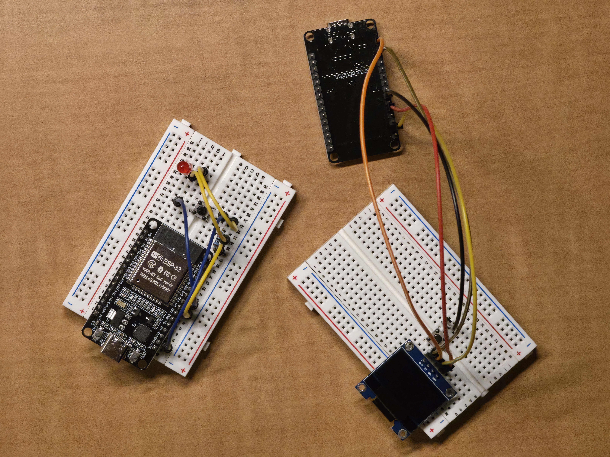

# Click ESP32 Bracelet Prototype

A 48-hour hackathon prototype that exchanges taps between two ESP32 boards and syncs timestamped encounters to a local website. Sign-in and profile setup use demo accounts.

## My Role
I assembled and debugged the circuits, calibrated Bluetooth proximity, and tested the complete exchange and sync flow. My teammate created the website design and artwork. I leveraged AI tooling to accelerate firmware and web integration, while mainly focusing on hardware assembly.


## Run on Windows

1. Install [Node.js 24 LTS](https://nodejs.org/) and use desktop Chrome with Bluetooth enabled.
2. Download the prototype ZIP from [Releases](https://github.com/yellowbench/Click-Prototype/releases) and extract it.
3. Open `Start Click.cmd`, keep its terminal open, and visit **http://localhost:8081/**.

Use **Ctrl+C** in the terminal to stop the server. The runtime uses Node's built-in modules.

## Test the Prototype

**Without hardware:** Choose **Continue with Google → Skip for now**, then complete the demo profile and add a test social handle. The timeline starts empty.

## With two ESP32 boards:

1. Upload the matching sketches in `firmware/`. Each sketch's opening comments list its wiring, libraries, and Arduino settings. Board A uses an OLED and defaults to `USER_101`. Board B uses an LED and defaults to `USER_202`.
2. Open two Chrome windows and pair a different board in each. Pairing sets the board's clock and syncs existing encounters. Complete profile setup using test names and handles.
3. **Disconnect both browser windows**, hold the boards face-to-face, and press **one** push button. Wait for `ENCOUNTER SAVED`.
4. Use **Sync bracelet** to reconnect each board. Each timeline shows the other person and the tap time.

## Guides and demonstrations

- [Materials and circuit photos](docs/Materials%20%26%20Circuit%20Assembly.pdf)
- [Visual syncing instructions](docs/Sync%20Guide.pdf)
- [Close-range and distance-test GIFs](Video%20Demonstrations%20-%20GIF/)

Demo names and encounters are saved locally in `.click-preview/encounters.sqlite`.

<details>
<summary>Optional troubleshooting and technical notes</summary>

If port 8081 is busy, close the other preview or open PowerShell in the extracted folder and run:

```powershell
$env:CLICK_PREVIEW_PORT = '8082'
node scripts/preview-bracelet.mjs
```

Then visit **http://localhost:8082/**.

- A previously saved board owner ID takes precedence over the sketch's default ID.
- Repeated syncs retain one entry per encounter. Confirmed records are saved locally before the website acknowledges them and frees their board slots.
- Proximity is tuned for the original hardware, so spacing may vary on other boards.
- During development, I isolated an ESP32 with repeated brownout resets through A/B testing. Replacing the board restored operation.
- Future work explores an nRF52840 wearable.
- [Manrope font license](licenses/Manrope-OFL.txt)

</details>



